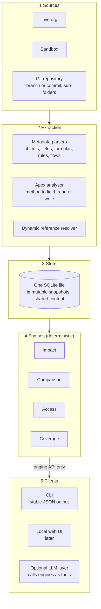
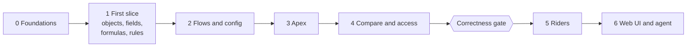

# OrgLens re-architecture plan

Agreed on 11 November 2026 · The OrgLens Authors

> This is the plan the project was started from, kept as it was agreed. Each phase has its own plan in this
> folder, written just before the phase starts, and decisions are recorded in [`docs/adr/`](../adr/). Where a
> phase plan or a decision record differs from this document, the newer one wins. The
> [Phase 0 plan](phase-0.md) lists six research findings that revise assumptions made here, including the
> Phase 0 effort and the list of Apex parser candidates.

## Summary

OrgLens is rebuilt from scratch in TypeScript as an open-source, local-first impact analysis tool for Salesforce, using the three existing repositories as input and none as the baseline.

The plan rests on five choices:

- **Impact analysis comes first.** Everything else waits until impact results pass a correctness gate on a real org of 10,000+ components.
- **Answers are deterministic.** A dependency graph produces every result. The LLM is optional and only explains.
- **Field-level precision is required.** References run from Apex method to field, with read or write and the exact source line.
- **Nothing is silently missed.** Every reference carries a confidence tier, dynamic references are resolved where possible, and Salesforce's own dependency data is used as a cross-check.
- **One simple store.** A single SQLite file holds immutable snapshots of every org, sandbox and repo branch, so every comparison is the same operation.

Rough effort to the correctness gate is 24 to 35 focused weeks for one developer with AI assistance. No deadline applies.

## Goal statement

Confirmed on 11 November 2026.

**Purpose.** OrgLens builds a local, queryable model of a Salesforce org and tells people what a change will affect before they make it. Impact analysis is the core capability. Automation order, integration mapping, security audit, documentation and free-form Q&A build on the same model and come second.

**Users.** Salesforce architects, developers, consultants and admins. The first users are the maintainer and colleagues on client work. The first release targets terminal users. Admins are served later through a graphical interface.

**Impact analysis must answer four questions.**

1. What references this field, class, flow or other component?
2. What breaks if it is changed or deleted?
3. What will this pull request or change set affect before deployment?
4. Who gains or loses access?

**Required behaviour.**

- Deterministic answers with no LLM. The LLM is optional and only explains and summarises.
- The live org is the primary source. Git repositories are the second.
- Comparisons are first-class: org vs repo branch, org vs sandbox, sandbox vs repo branch.
- One workspace holds several orgs. One repo can hold several orgs in separate sub-folders.
- Works on orgs with 10,000+ metadata components.
- Works with any LLM provider, including local models.
- Delivery order: CLI, then a local web UI on the user's machine, then a desktop app. No hosted service for now.
- Metadata and code stay on the user's machine by default.
- Read-only against every org.
- States what it did not ingest or could not resolve. A missed dependency is the worst failure.

**Constraints.** One developer with AI assistance. No deadline. Time is nearly the whole budget. Language and stack were open.

**Success criteria.**

1. The maintainer and colleagues rely on it in real client engagements and act on its impact answers.
2. It handles a 10,000+ component org with acceptable ingest and query times.
3. Outside adoption grows, with GitHub stars as the visible measure.

## Decision log

All 27 decisions were agreed on 11 November 2026. In the reasoning, A is `orgLens`, B is `salesforce-orglens` and C is `orglens-claude`.

### Features and scope

| ID | Decision | Chosen option | Reasoning |
| --- | --- | --- | --- |
| F1 | First release scope | Impact core first, then automation order, integration map and basic security audit as riders | Riders are mostly queries over the same graph. No rider starts until impact analysis passes the correctness gate. |
| F2 | Role of the LLM | Optional: explains results, later an agent that calls the engines as tools. No RAG, vectors or embeddings | Embeddings were the heaviest dependency and served a secondary feature. Exact graph queries beat similarity search on structured metadata. |
| F3 | Metadata coverage | Logic tier first. Presentation tier is the next milestone, reports opt-in | The logic tier covers everything that can break at runtime. Reports can number in the tens of thousands. |
| F4 | Removals | Remove RAG, the binary build and unused dependencies. No live record-data queries. Defer docs generation, dead code and posture audit | Record queries pull business data and weaken the local-first promise. Impact analysis does not need them. |

### Architecture

| ID | Decision | Chosen option | Reasoning |
| --- | --- | --- | --- |
| A1 | Overall structure | One engine library in five layers. CLI, web UI and LLM layer are clients of one engine API | New clients are additions, not rewrites. The LLM cannot bypass the engines. |
| A2 | Storage | One embedded relational database, no graph database | One file and one consistency model. Target scale is small for this approach. |
| A3 | Multi-org and comparison | Immutable snapshots of every source in one workspace | Every comparison becomes a diff of two snapshots. History comes free. |
| A4 | Source of dependencies | Own static analysis as primary, Salesforce Dependency API as a cross-check, provenance on every reference | Own analysis works for orgs and repos. The cross-check is the correctness oracle no earlier build had. |
| A5 | Org ingestion | Retrieve in source format through the Metadata API, one parser path shared with Git repos | Org and repo snapshots are directly comparable. B proved the route on a large org. |

### Design

| ID | Decision | Chosen option | Reasoning |
| --- | --- | --- | --- |
| D1 | Data model and identity | Component and Reference records. Keys are type plus qualified API name and do not contain the org | The same component in production, a sandbox and a repo shares one key, so comparison is a join. |
| D2 | Apex granularity | Method to field, with read or write, plus exact source location | Tight impact chains. Showing the line is the fastest way to earn or lose trust. |
| D3 | Meaning of "what breaks" | Reachability first, then change-aware rules starting with delete and data-type change | Useful early, with a path to the real differentiator. |
| D4 | Access impact | Metadata only by default. User assignments are an explicit opt-in, counts only | No personal data is read unless the user asks. |
| D5 | Authentication | Salesforce CLI login by default, JWT through environment variables for CI | OrgLens stores no credentials. |
| D6 | Commands and configuration | Fixed command set with stable JSON output. Committable `orglens.toml`, local `.orglens/` data folder | The JSON format is the contract for the web UI, CI and the agent. Colleagues can clone and rerun. |
| D7 | Dynamic references | Resolution sequence: query-string text, custom metadata and field sets, then tracing through the Apex. Three confidence tiers. Residue becomes object-level "possible" dependencies | Proposed by the maintainer. The full field inventory makes text matching reliable. Erring toward extra "possible" entries is the right side for this tool. |

### Technical stack

| ID | Decision | Chosen option | Reasoning |
| --- | --- | --- | --- |
| S1 | Language | TypeScript on Node | Salesforce's own libraries and the Apex parsers live there. Engine, CLI and UI share one language. |
| S2 | Database | SQLite | One file, keyword search, recursive queries, safe concurrent reads. Kuzu was archived by its sponsor. |
| S3 | Apex analysis foundation | Decided by a short trial of three candidates | The choice determines months of effort and cannot be settled from documentation. |
| S4 | Salesforce connectivity | `@salesforce/core` and `@salesforce/source-deploy-retrieve` | Auth, retrieval and repo reading without new code. |
| S5 | LLM layer | Small internal interface with OpenAI-compatible and Anthropic adapters | Covers hosted and local providers. Library chosen when the layer is built. |
| S6 | Licence | Apache 2.0 | Explicit patent grant and clear contribution terms. |

### Migration

| ID | Decision | Chosen option | Reasoning |
| --- | --- | --- | --- |
| M1 | Approach | Rewrite, harvesting fixtures, parser logic, coverage manifest, trust features and the change-set preview flow | No existing repo shares a language, store or identity scheme with the target. |
| M2 | Repository | New repository. The three old ones are archived later with a pointer | Clean history and licence. Nothing is archived without explicit go-ahead. |
| M3 | Build order | Thin end-to-end slice first, then widen by metadata family. Apex trial runs alongside | Usable within weeks. Design mistakes surface while cheap. |
| M4 | Proof of correctness | Fixture project with known answers, large public codebases, one real 10,000+ component org | Gate: no confirmed Salesforce-reported dependency is missing, and every difference is explained. |
| M5 | Going public | Public repository from the start, marked pre-release, announced after the gate | Colleagues can use it normally. The launch is saved for when claims are backed up. |

## Target architecture

OrgLens is one engine library in five layers, and every client reaches the data only through the engine API.

Data flows top to bottom. Impact is highlighted because it is the capability the first release is judged on.

### Layers

1. **Sources.** A live org, a sandbox, or a Git repository at a branch or commit with a declared set of sub-folders. Sources are declared in `orglens.toml`.
2. **Extraction.** Orgs are retrieved in source format, so orgs and repos share one set of parsers. The Apex analyser produces method-level references. The dynamic reference resolver handles query strings, custom metadata, field sets and string construction in Apex.
3. **Store.** One SQLite file in `.orglens/`. Every ingest writes an immutable snapshot. Unchanged content is stored once and shared between snapshots.
4. **Engines.** Impact, comparison, access and coverage. All deterministic. They return structured results with the path that explains each one.
5. **Clients.** The CLI with stable JSON output, later a local HTTP server with a browser UI, and the optional LLM layer. The LLM layer calls the engines as tools and never reads the store directly.

### Data model

- **Component.** Anything that can be referenced or changed, down to field, Apex method and flow element. The key is type plus fully qualified API name, including namespace. The key does not contain the org. Source and snapshot are separate columns.
- **Reference.** A directed link with a kind from a fixed vocabulary (reads, writes, calls, extends, triggers on, grants, contains), an origin, a confidence tier and a source location.
- **Snapshot.** One ingest of one source at one point in time, with its coverage manifest.

### Confidence tiers

| Tier | Meaning | Typical origin |
| --- | --- | --- |
| Confirmed | Resolved statically or fully | Parsed Apex, Flow elements, formulas, Dependency API agreement |
| Probable | Resolved from text or metadata with the object identified | Query-string literals, custom metadata field mappings, field sets |
| Possible | Object known, field decided at runtime | Record-driven field names, user input, describe loops |

### How a dependency is established

1. Static analysis extracts references from every parsed component.
2. Dynamic references go through the resolution sequence: text inside query strings, then custom metadata records and field sets, then tracing how strings are built in Apex.
3. For live orgs, Salesforce Dependency API records and compiler symbol data are ingested as a second source.
4. Agreements raise confidence. Disagreements are reported in the coverage output.
5. What remains unresolved is stored as an object-level "possible" dependency, never dropped.

### How the four impact questions map to engines

| Question | Engine | Mechanism |
| --- | --- | --- |
| What references this component | Impact | Inbound traversal over references in one snapshot |
| What breaks if changed or deleted | Impact | Traversal plus change-aware rules, starting with delete and data-type change |
| What will this change set affect | Comparison, then Impact | Diff two snapshots or two Git refs, then run impact on each changed component |
| Who gains or loses access | Access | Grant references per profile, permission set and group, diffed between snapshots |

## Recommended tech stack

The stack is TypeScript on Node with SQLite, built on Salesforce's own open-source libraries.

| Concern | Choice | Status |
| --- | --- | --- |
| Language and runtime | TypeScript on Node | Decided (S1) |
| Database | SQLite, with its built-in full-text search for keyword lookup | Decided (S2) |
| Salesforce auth | `@salesforce/core`, reading existing Salesforce CLI logins. JWT through environment variables for CI | Decided (S4, D5) |
| Retrieval and repo reading | `@salesforce/source-deploy-retrieve` | Decided (S4) |
| Apex analysis | One of `@apexdevtools/apex-parser`, `tree-sitter-sfapex` or `@apexdevtools/apex-ls` | Decided by trial in roadmap phase 0 (S3) |
| Apex cross-check | Tooling API compiler symbol data and the Dependency API | Decided (A4) |
| LLM access | Internal interface with OpenAI-compatible and Anthropic adapters | Decided in principle (S5). Library chosen when built |
| Distribution | npm package with an `orglens` command | Follows from S1. A Salesforce CLI plugin is an open question |
| Licence | Apache 2.0 | Decided (S6) |
| Web UI framework | Not chosen | Deferred until the CLI is proven |
| Desktop wrapper | Not chosen | Deferred |

Explicitly not in the stack: DuckDB, Kuzu, LanceDB, embeddings, LlamaIndex, LiteLLM, and the Python-to-Node bridge.

The SQLite driver, test runner, CLI framework and XML parser are implementation choices for phase 0. They are easy to change and do not need a recorded decision.

Library facts checked on 11 November 2026: [Kuzu archived](https://oneuptime.com/blog/post/2026-08-12-kuzu-archived-pin-0-11-3-fork-or-migrate/markdown), [apex-ls](https://www.npmjs.com/package/@apexdevtools/apex-ls), [tree-sitter-sfapex](https://docs.rs/crate/tree-sitter-sfapex/latest), [source-deploy-retrieve](https://www.github.com/forcedotcom/source-deploy-retrieve). I confirmed that these exist and are published. I did not test their capabilities, which is what the phase 0 trial is for.

## Roadmap

Seven phases lead from an empty repository to a local web UI, with one gate between the impact core and everything else.

Phases 0 to 4 build the impact core. The riders, the LLM features and the web UI start only after the gate.

Effort is in focused weeks for one developer with AI assistance. These are rough estimates, not commitments. Phase 3 carries the widest range because it depends on the Apex trial.

| Phase | Delivers | Rough effort | Depends on |
| --- | --- | --- | --- |
| 0 Foundations | New repository, Apache 2.0, CI on three operating systems, decision records. Workspace, `orglens.toml`, source declarations. First retrieve from a real org. Apex trial of the three candidates. First version of the fixture project. | 2 to 3 weeks | Nothing |
| 1 First slice | Objects, fields, formula fields and validation rules through every layer: snapshot, store, impact by reachability, coverage, CLI with JSON output. Usable on real orgs for field-to-formula and field-to-rule impact. | 4 to 6 weeks | Phase 0 |
| 2 Flows and config | Flows at element level with field reads and writes. Workflow rules, record types, custom metadata types and their records, field sets. Port B's Flow parser, verified against B's fixtures. | 3 to 4 weeks | Phase 1 |
| 3 Apex | Classes and triggers at method level with read, write and source location. Dynamic reference resolution and the three confidence tiers. Dependency API and compiler data as cross-check. LWC and Aura links to Apex. Named credentials. | 8 to 12 weeks | Phase 0 trial result, phase 1 |
| 4 Compare and access | Snapshot comparison for all three pairings. Multi-org workspace and repo sub-folder mapping. Change-set impact from a Git diff. Incremental refresh. Profiles, permission sets and groups, with access impact. Change-aware rules for delete and data-type change. | 5 to 7 weeks | Phases 1 to 3 |
| Correctness gate | Run on public codebases and one real 10,000+ component org. Fix every missing dependency. Measure ingest and query times. Publish the benchmark. Announce. | 2 to 3 weeks | Phase 4, access to a suitable org |
| 5 Riders | Automation order of execution, integration map, basic security audit. `orglens explain` through the LLM layer. | 4 to 6 weeks | Gate passed |
| 6 Web UI and agent | Local HTTP server and browser UI. `orglens ask` as an agent over the engines. Presentation tier: layouts, Lightning pages, list views, email templates, sharing rules, opt-in reports. | 6 to 10 weeks | Phase 5 |

Total to the gate is 24 to 35 focused weeks. Phases 5 and 6 add 10 to 16.

Later, with no estimate yet: desktop app, documentation and diagram generation, dead-code detection, security posture audit, more change-aware rules, a possible Salesforce CLI plugin.

### What is reused in each phase

- **Phase 0:** C's CI matrix and release workflow as a model. B's decision-record habit.
- **Phases 1 and 2:** B's metadata fixtures and expected parser outputs as test data. B's parsers as the reference for each port. C's coverage manifest design.
- **Phase 3:** B's `apex-bridge` and symbol-table extraction as a starting point for the trial.
- **Phase 4:** A's Git-diff-to-PR-comment flow. B's permission grant parsing.
- **Phases 5 and 6:** B's and C's automation, integration and audit rules. C's data-policy modes, secret scanning, agent loop and evaluation harness.

## Key risks

The two risks that could sink the product are Apex analysis proving harder than planned and impact results that silently miss dependencies. Risks are listed by impact on the goal.

| # | Risk | Why it matters | Mitigation |
| --- | --- | --- | --- |
| 1 | Method-level Apex analysis with type resolution is harder than estimated | It is the largest and least certain piece of work, and D2 depends on it | Trial three foundations in phase 0 before committing. Ship class-level references as "probable" first if needed, then tighten. Keep the analyser behind one interface so it can be replaced. |
| 2 | Results are wrong by omission | One missed dependency in front of a client destroys trust | Dependency API and compiler cross-check. Coverage manifest on every snapshot. Fixture project with deliberate hard cases. The correctness gate before any announcement. |
| 3 | Text matching produces too many false positives | Long "possible" lists get ignored, which hides real results | Three tiers shown separately. Confirmed results first by default. Measure the false-positive rate on public codebases and tune. |
| 4 | Scope creep by a solo developer | Three earlier builds went broad before deep | The F1 rule: no rider before the gate. Thin slices. Deferred list kept in the plan, not in the backlog. |
| 5 | Large-org retrieval is slow or hits limits | 10,000+ components is the stated target and no build is proven there | Chunked and resumable retrieves from phase 0. Incremental refresh in phase 4. Reports opt-in. Test on a large org early, not at the gate. |
| 6 | The Dependency API is incomplete or limited on large orgs | The cross-check may not cover every type or every record | Treat it as a second opinion, never the primary source. Query per type. Record what it did not cover in the coverage manifest. |
| 7 | A key third-party library is abandoned or changes | Kuzu was archived under two earlier builds | Prefer Salesforce-maintained libraries. Isolate each behind a layer boundary. Check maintenance health as part of the Apex trial. |
| 8 | The rewrite loses value from the old repositories | B's parsers encode many real-world fixes | Reuse B's fixtures as tests for the port. Keep B runnable as a comparison tool until phase 3 ends. |
| 9 | Client confidentiality during real-org testing | Level 3 of the proof needs a client org | Client permission first. Everything stays on the local machine. Nothing from client orgs enters public benchmarks, fixtures or issues. |
| 10 | Local LLM models are weak at tool calling | "Any provider" may underdeliver for the agent | The LLM is optional by design. `explain` needs no tool calling. State the tested models in the docs. |
| 11 | Motivation and momentum over 6 to 9 months of solo work | No deadline and no outside pressure | The first slice is usable within weeks. Colleagues use it from phase 1. Each phase ends with a release. |

## Open questions

Twelve questions remain. The first four should be settled before or during phase 0.

**Before or during phase 0**

- [ ] **Performance targets.** "Acceptable" is still undefined. Proposed for a 10,000-component org: first full snapshot under 30 minutes, incremental refresh under 5 minutes, impact query under 2 seconds, comparison under 10 seconds. The maintainer to confirm or replace.
- [ ] **Project and package name.** Is `orglens` free on npm and GitHub, and is the name clear of existing trademarks? Not checked.
- [ ] **Which real org is the gate run on,** and will the client permit it? Finding this early also allows large-org testing before the gate.
- [ ] **Which public codebases are used for level 2 of the proof.** Candidates need to be large, open and deployable to a free org. Not yet selected.

**Resolved by planned work**

- [ ] **Apex analysis foundation.** Decided by the phase 0 trial (S3).
- [ ] **Scope of the Dependency API on large orgs.** Its limits and type coverage need measuring during phase 3.
- [ ] **Managed packages.** Their code is hidden. How are references into and out of a namespace shown, and at what confidence?

**Design details to settle when reached**

- [ ] **Snapshot retention.** How many snapshots are kept per source by default, and how are old ones pruned?
- [ ] **Sharing between colleagues.** Does each person ingest their own snapshots, or can a workspace file be exported and shared? The second touches client confidentiality.
- [ ] **Salesforce CLI plugin.** Standalone `orglens` command only, or also `sf orglens`? When?
- [ ] **Old repositories.** When are the three archived, and is the plain `orgLens` name freed for the new project? Needs the maintainer's explicit go-ahead.
- [ ] **Use of the money budget.** Proposed: LLM usage for evaluation runs after the gate, and paid org capacity if a free org cannot hold the level 2 codebases.

**Deferred by decision, listed so they are not forgotten:** web UI framework, desktop wrapper, LLM client library, browser login for admins, presentation-tier metadata, reading custom settings records.
