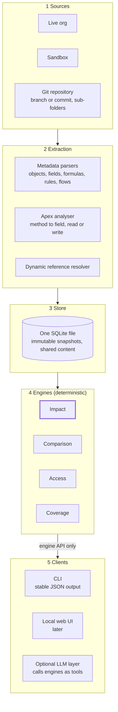
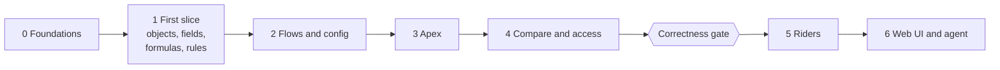

# OrgLens re-architecture plan

Agreed on 11 November 2026 · The OrgLens Authors

> This is the plan the project was started from. It is updated when a phase is closed, and the section
> [Changes since the plan was agreed](#changes-since-the-plan-was-agreed) lists what was changed and when. The
> goal statement is never changed without the maintainer. Each phase has its own plan in this folder, written
> just before the phase starts, and decisions are recorded in [`docs/adr/`](../adr/). Where a phase plan or a
> decision record differs from this document, the newer one wins.
>
> Last updated on 22 November 2026, when the maintainer answered the questions of the Phase 2 plan and approved it. Before that: on 17 November 2026, at the close of Phase 1, on 15 November 2026, with the answers of the maintainer to the Phase 1 plan and the approval of that plan with one change, and on 13 November 2026, at the close of Phase 0 and when the maintainer chose the Apex parser.

## Summary

OrgLens is rebuilt from scratch in TypeScript as an open-source, local-first impact analysis tool for Salesforce, using the three existing repositories as input and none as the baseline.

The plan rests on five choices:

- **Impact analysis comes first.** Everything else waits until impact results pass a correctness gate on a real org of 10,000+ components.
- **Answers are deterministic.** A dependency graph produces every result. The LLM is optional and only explains.
- **Field-level precision is required.** References run from Apex method to field, with read or write and the exact source line.
- **Nothing is silently missed.** Every reference carries a confidence tier, dynamic references are resolved where possible, and Salesforce's own dependency data is used as a cross-check.
- **One simple store.** A single SQLite file holds immutable snapshots of every org, sandbox and repo branch, so every comparison is the same operation.

Rough effort to the correctness gate is 30 to 39 focused weeks for one developer with AI assistance. No deadline applies.

## Changes since the plan was agreed

### At the close of Phase 0, 13 November 2026

The reasons and the measurements are in the [Phase 0 report](../reports/phase-0.md).

| What | Before | Now |
| --- | --- | --- |
| Decision A4, the cross-check from Salesforce | The Dependency API and compiler symbol data | The Dependency API alone. The symbol table an org keeps holds no reference. The maintainer decided on 12 November 2026 that the Dependency API alone is the cross-check for Apex and that nothing is compiled in the test org. Record [0034](../adr/0034-dependency-api-is-the-cross-check.md) writes that down and says which of its sentences go further than what the maintainer decided. |
| Decision S3, the Apex parser | A trial of three candidates | `apex-ls` was dropped before the trial: its analyser runs on Java only. The trial of the other two found them equal in output and both within the marks. Its author recommended `web-tree-sitter-sfapex`, which is about five times as fast, and the trial selected none: the tie-break needs a judgment. The maintainer chose `web-tree-sitter-sfapex` on 13 November 2026, record [0018](../adr/0018-apex-analysis-foundation.md). |
| Decision M1, what is taken from the old repositories | Fixtures, parser logic and designs | Designs and ideas only. No fixture, recording or code is copied. The old repositories hold test inputs without expected outputs, and the data rules of this repository forbid copying a fixture, a recording or code from them (record [0020](../adr/0020-rewrite-in-new-repository.md)). Every fixture and every expected answer is written fresh. |
| Decision S4, how an org is retrieved | The retrieve of `@salesforce/source-deploy-retrieve` | Four requests of the Metadata API that OrgLens makes itself. The library converts the files of a retrieve and reads source folders. Record [0009](../adr/0009-one-ingestion-path.md) stays the record of S4. Record [0032](../adr/0032-reading-an-org.md), a decision of the build, says how the retrieve is done. |
| Phase 0 effort | 2 to 3 weeks | 4 to 5 weeks of work as the Phase 0 plan counted it. The total to the gate moved from 24 to 35 weeks to 26 to 37. |
| Roadmap | Phase 0 open | Phase 0 built. It is closed when the maintainer has run the [test plan](../test-plans/phase-0.md). |
| Stack table, database | SQLite | SQLite through Node's own `node:sqlite`, with `better-sqlite3` as the tested fallback (record 0025). |
| Stack, the smaller choices | "Implementation choices for phase 0" that need no record: SQLite driver, test runner, CLI framework, XML parser | The driver, the test runner and the CLI framework are chosen. No XML parser is chosen: the engine reads no XML yet. |
| Roadmap, Phase 0 | Trial of three parsers, "first retrieve from a real org" | What was built: see the row of the roadmap. |
| Roadmap, Phases 2 and 3 | Port B's Flow parser and verify it against B's fixtures. The Dependency API and compiler data as cross-check | B's Flow parser is a model for the design only. The Dependency API alone. |
| Roadmap, Phase 4 | Comparison, access impact | Two things Phase 0 found are added to it: a comparison has to know the default values an org adds to almost every file, and profiles and permission sets have to be read completely, which a retrieve in chunks does not do. The estimate of 5 to 7 weeks was not raised for them, and that is not checked. |
| What is reused in each phase | Fixtures, expected outputs and parser code of B | Ideas and designs only. |
| Risks | 11 risks | Risks 1, 2, 5, 6, 7 and 8 are rewritten with what was measured, and risk 11 names that Phase 0 ended without a release. Risk 8 no longer says "Reuse B's fixtures" and "Keep B runnable as a comparison tool until phase 3 ends": nothing is copied from the old repositories, and they are not touched. Risks 12 and 13 are new. |
| Open questions | 12 questions | Two are answered: the public codebases and the Apex parser. The project and package names are chosen and not checked. Four are new. The heading "Before or during phase 0" is now "From the start of the project", because two of its questions, the performance targets and the org for the gate, were not settled in Phase 0. |
| The note at the head of this document | "The plan the project was started from, kept as it was agreed" | The plan is updated when a phase is closed, and this section lists the changes. |

What Phase 0 says about the estimates: they were made in weeks of a developer who works with AI assistance. Phase 0
was built in two calendar days by an AI assistant. The weeks are kept as a measure of the size of a phase. They
are a poor forecast of elapsed time, which depends on the reviews and decisions of the maintainer and on access to
orgs.

### With the answers to the Phase 1 plan, 15 November 2026

The maintainer answered the eight questions of the [Phase 1 plan](phase-1.md) on 15 November 2026. The
maintainer approved that plan on the same day with one change. The next section holds the change, and it
replaces the row "What a snapshot of an org reads" below.

| What | Before | Now |
| --- | --- | --- |
| Performance targets | Open. Proposed for an org of 10,000 components: 30 minutes, 2 seconds, 10 seconds, 5 minutes | Set by the maintainer for an org of 100,000 components: first snapshot under 60 minutes, impact query under 5 seconds, comparison under 10 seconds, incremental refresh under 5 minutes. How a component is counted is open: by one count the target is about twice the synthetic org of Phase 0, by another about ten times (record [0037](../adr/0037-performance-targets.md)). Nothing measured supports the 60 minutes by either count. |
| The goal for metadata coverage | Decision F3: the logic tier, then the presentation tier, reports opt-in | The maintainer noted the goal: all metadata, except what comes from managed packages. That F3 still sets the order in which types are built is a reading of the author of record 0036, not a statement of the maintainer. How packages are left out is not decided. |
| What a snapshot of an org reads | Every type the org lists. Partial when anything listed did not come back | The logic tier by default. Complete when every listed component of the types it reads came back and could be read. Record [0036](../adr/0036-what-a-snapshot-of-an-org-reads.md). That custom labels, custom permissions and global value sets are added to the default is a reading of the author of that record. Replaced on the same day: see the next section. |
| The correctness gate | No dependency that Salesforce confirms is missing | A second half for standard fields, names in text, lookups and roll-up summaries: every entry of the answer key is found, and a random sample from public codebases is checked by hand. Record [0035](../adr/0035-gate-where-salesforce-confirms-nothing.md). The estimate of the gate was not looked at again. |
| The Dependency API in the engine | Phase 3, with Apex | Phase 1, for the types Phase 1 analyses. Phase 3 extends it to Apex. |
| Roadmap, Phase 1 | 4 to 6 weeks | 6 to 7 weeks: the cross-check and the rule for what a snapshot reads are added. The total to the gate is 28 to 38 weeks. What Phase 3 saves is not estimated. |
| Decision D6, the command set | Fixed | The command `orglens analyse` is added in Phase 1. Record [0043](../adr/0043-a-snapshot-is-analysed-from-its-files.md). |
| The reader for XML | `fast-xml-parser` behind a wrapper, named in the Phase 0 plan | A reader of our own, with `fast-xml-parser` as the second opinion in tests. A maintained library that gives the place of every character was looked for on the first day of that work and not found. Record [0039](../adr/0039-a-reader-of-our-own-for-xml.md). |
| How colleagues get the first slice | Open (risk 11) | A pre-release on GitHub with the packed command line attached. Nothing on npm yet. |
| Risks and open questions | | Risks 5, 11 and 13 follow the answers. Three open questions are answered: the performance targets, the gate where Salesforce confirms nothing, and what "complete" means. The open question "Managed packages" is extended and stays open. |

### With the approval of the Phase 1 plan, 15 November 2026

The maintainer chose "Approve with changes" for the Phase 1 plan on 15 November 2026 and named the change in these words: "metadata to index/retrieve should cover almost everything in the org: Custom objects/fields, flows and their elements, Apex classes and their methods, email templates, report types, reports, permission sets, permissin set groups, ...." The author put two readings of it to the maintainer, who chose the first: a snapshot reads every type from Phase 1 on, and references are found phase by phase (record [0038](../adr/0038-a-snapshot-reads-every-type.md)).

| What | Before | Now |
| --- | --- | --- |
| What a snapshot of an org reads | The logic tier by default (record 0036, earlier on the same day) | Every type the org lists. Complete is judged over the logic tier. That what is missing in another type is a warning is a reading of the author of record 0038. To be built in Phase 1. |
| Reports | Opt-in (decision F3) | Read by default. Not analysed before a phase builds an analyser for them. |
| The order of the analysers | The roadmap | Unchanged, as a reading of the author of record 0038. Report types are in no phase. Where email templates, report types and reports go is put to the maintainer when Phase 2 is planned. |
| The target of 60 minutes for a first snapshot | No measurement supports it (record 0037). Reading fewer types was expected to help | Still no measurement supports it, and a snapshot does not read fewer types. |
| The Phase 1 plan | Answered, not approved | Approved with this change. The approval was given before the change was written, and the maintainer has not read the changed text. Open: how the components of the performance targets are counted (record 0037). |
| Record 0036 | Accepted | Superseded by record 0038. |
| Elsewhere in this plan | | Row F3 of the decision log, the row of Phase 6 and the list "Later" of the roadmap, risks 5 and 13, and the open questions "Managed packages", "What complete means" and "Folders inside folders" follow the change. |

### At the close of Phase 1, 17 November 2026

The reasons and the measurements are in the [Phase 1 report](../reports/phase-1.md).

| What | Before | Now |
| --- | --- | --- |
| Roadmap, Phase 1 | To be built | Built. It is closed when the maintainer has run the [test plan](../test-plans/phase-1.md), whose main part is a run on an org the maintainer knows. |
| What an impact result holds | "Structured results with the path that explains each one" | A result holds the one reference it is found by, and the other end of that reference is a result of the depth before. With every path written out, one answer from the synthetic org was 443 MB of JSON. Record [0044](../adr/0044-an-impact-answer.md), as a choice of its author that the maintainer can strike. |
| The rows of the Dependency API | "Ingested as a second source", and "agreements raise confidence" | Kept beside the snapshot as Salesforce wrote them. They are no references, and `impact` shows none. A pair Salesforce reports and the analysis lacks is an error of the analysis. An agreement raises no confidence. Record [0045](../adr/0045-the-cross-check-of-a-snapshot.md), as choices of its author. |
| When a snapshot of an org is complete | Decided, to be built | Built: 21 types of the logic tier, named by record [0046](../adr/0046-complete-over-the-logic-tier.md). On the test org 209 of 222 components that do not come back are warnings now. Six components of the tier still keep its snapshot partial: Salesforce hands them out in no way the engine can ask. The maintainer decided on 17 November 2026 that such a component stays an error. |
| Leaving types out of a snapshot | Proposed in the Phase 1 plan | Built: the key `exclude_types` of a source in `orglens.toml`. The maintainer chose to keep it on 17 November 2026 (record [0048](../adr/0048-types-a-snapshot-leaves-out.md)). Not run against a real org. |
| Public codebases | apex-recipes, Nebula Logger and NPSP | PMM is the fourth, for its validation rules and lookup filters. |
| How colleagues get the first slice | A pre-release on GitHub, to be made | The way to it is built: a workflow, version `0.1.0-next.0`, release notes (record [0050](../adr/0050-the-pre-release-on-github.md)). A rehearsal of the workflow without the publishing passed on Linux, Windows and macOS. The review found that a global install from an address is replaced by whatever the registry of npm holds under the two names as soon as a user runs `npm update --global`, and nobody held the names for this project (risk 14). The maintainer decided on 17 November 2026 that a pre-release fixes neither the names nor the JSON output (record [0051](../adr/0051-the-first-release-is-the-first-on-npm.md)), and that the project holds its names on npm with empty packages. The review of the second decision found that the policy of npm forbids such packages (record 0052, never accepted). The maintainer then chose, on the same day, to publish the pre-release itself on npm under the tag `next`, by the workflow, in an environment that waits for the maintainer's approval (record [0053](../adr/0053-a-pre-release-is-published-on-npm.md)). The maintainer also decided that a pre-release on npm fixes neither the names nor the JSON output. Version `0.1.0-next.0` was published that way on 17 November 2026, on the maintainer's word and with the maintainer's approval of the job, with a token: [run 5 of the workflow](https://github.com/taouani/sf-orglens/actions/runs/44164088211). The maintainer chose on the same day to publish a second pre-release without a change, `0.1.0-next.1`, to try trusted publishing, which the later pre-releases use, before the trusted publishers expired (record [0054](../adr/0054-a-pre-release-without-a-change-is-published.md)). It was published that evening without a token, on the maintainer's word and with the maintainer's approval of the job: [run 7 of the workflow](https://github.com/taouani/sf-orglens/actions/runs/44194660408). |
| Phase 1 effort | 6 to 7 weeks | About 33 developer-days as the Phase 1 plan counted them, built in three calendar days. The estimates stay a measure of size. |
| Roadmap, Phase 2 | 3 to 4 weeks | The draft of the [Phase 2 plan](phase-2.md) estimates about 5 weeks, with managed packages and three more types in it. It is not approved, so the row of the roadmap and the total to the gate are not changed. |
| Risks | 13 risks | Risks 2, 5, 6, 11, 12 and 13 are rewritten with what Phase 1 measured. Risk 14 is new: the install of a pre-release. |
| Open questions | 16 questions | Four are new. Four are updated: the performance targets, the names, the public codebases and the scope of the Dependency API. |

### With the approval of the Phase 2 plan, 22 November 2026

The maintainer answered the six questions of the [Phase 2 plan](phase-2.md) and approved it. The plan holds the answers. Four of them change this plan.

| What | Before | Now |
| --- | --- | --- |
| Roadmap, Phase 2 | Flows, workflow rules, record types, custom metadata types and their records, field sets. 3 to 4 weeks | Email templates, report types and quick actions join it (record [0055](../adr/0055-email-templates-report-types-and-quick-actions-in-phase-2.md)), and so does the handling of managed packages (record [0056](../adr/0056-components-of-a-managed-package.md)). About 5 weeks, as the Phase 2 plan estimates. |
| Roadmap, Phase 6 and "Later" | Email templates and reports in Phase 6, report types in no phase | Reports stay in Phase 6. Email templates and report types are analysed in Phase 2. |
| Total to the gate | 28 to 38 weeks | 30 to 39 weeks, with Phase 2 at about 5. |
| Managed packages | An open question | Their components are read and kept, marked with their package, and left out of an answer as the thing that refers. They stay targets, and an option of `impact` shows them (record 0056). Not retrieving them at all stays open, to be decided with a number from an org of the maintainer. |
| Which version of a flow | Not asked | The one the org hands out (record [0057](../adr/0057-the-version-of-a-flow-that-is-analysed.md)). Which one that is, is measured in the first work package of Phase 2. |
| When a snapshot of an org is complete | The 21 types of the logic tier (record 0046) | Every type that has an analyser counts as well (record [0058](../adr/0058-a-type-counts-for-complete-once-it-is-analysed.md)). The list of record 0046 stays in force until work package 6 of Phase 2 builds the change. |

Not changed by the approval: Phase 1 is closed when the maintainer has run its test plan, and that run is still open.

What Phase 1 says about the proof: the four pass marks the maintainer accepted are met, and no reference that was checked is wrong. The check by hand was made by the author of the analyser and repeated by a second automated reader. No person has read an entry of the key or of the check, and no command was run on an org the maintainer knows.

## Goal statement

Confirmed on 11 November 2026.

**Purpose.** OrgLens builds a local, queryable model of a Salesforce org and tells people what a change will affect before they make it. Impact analysis is the core capability. Automation order, integration mapping, security audit, documentation and free-form Q&A build on the same model and come second.

**Users.** Salesforce architects, developers, consultants and admins. The first users are the maintainer and colleagues on client work. The first release targets terminal users. Admins are served later through a graphical interface.

**Impact analysis must answer four questions.**

1. What references this field, class, flow or other component?
2. What breaks if it is changed or deleted?
3. What will this pull request or change set affect before deployment?
4. Who gains or loses access?

**Required behaviour.**

- Deterministic answers with no LLM. The LLM is optional and only explains and summarises.
- The live org is the primary source. Git repositories are the second.
- Comparisons are first-class: org vs repo branch, org vs sandbox, sandbox vs repo branch.
- One workspace holds several orgs. One repo can hold several orgs in separate sub-folders.
- Works on orgs with 10,000+ metadata components.
- Works with any LLM provider, including local models.
- Delivery order: CLI, then a local web UI on the user's machine, then a desktop app. No hosted service for now.
- Metadata and code stay on the user's machine by default.
- Read-only against every org.
- States what it did not ingest or could not resolve. A missed dependency is the worst failure.

**Constraints.** One developer with AI assistance. No deadline. Time is nearly the whole budget. Language and stack were open.

**Success criteria.**

1. The maintainer and colleagues rely on it in real client engagements and act on its impact answers.
2. It handles a 10,000+ component org with acceptable ingest and query times.
3. Outside adoption grows, with GitHub stars as the visible measure.

**Notes since, not part of the confirmed text.** The text above is as the maintainer confirmed it and is not
changed. Two answers to the Phase 1 plan of 15 November 2026 and the change the maintainer made with its approval
touch it.

- The maintainer wrote with one answer: "the goal is all metadata except those coming from managed packages".
  Whether that becomes a line of the goal statement is for the maintainer to say.
- The maintainer set numbers for "acceptable", for an org of 100,000 components (record
  [0037](../adr/0037-performance-targets.md)). The second criterion, decision M4 and the gate still name an org
  of 10,000 or more components. How a component is counted in each of them is not decided.
- With the approval of the Phase 1 plan the maintainer wrote that the metadata to index and retrieve "should
  cover almost everything in the org", with a list of types (record
  [0038](../adr/0038-a-snapshot-reads-every-type.md)). From Phase 1 on a snapshot reads every type.

## Decision log

All 27 decisions were agreed on 11 November 2026. A4 was changed on 12 November 2026, S3 was completed with the choice of the parser on 13 November 2026, and the rows of S4 and M1 say what Phase 0 changed in them. The rows of F3, D6 and M4 say what the answers of the maintainer of 15 November 2026 changed, and the row of F3 says what in it is a reading of the author of records 0036 and 0038. In the reasoning, A is `orgLens`, B is `salesforce-orglens` and C is `orglens-claude`.

### Features and scope

| ID | Decision | Chosen option | Reasoning |
| --- | --- | --- | --- |
| F1 | First release scope | Impact core first, then automation order, integration map and basic security audit as riders | Riders are mostly queries over the same graph. No rider starts until impact analysis passes the correctness gate. |
| F2 | Role of the LLM | Optional: explains results, later an agent that calls the engines as tools. No RAG, vectors or embeddings | Embeddings were the heaviest dependency and served a secondary feature. Exact graph queries beat similarity search on structured metadata. |
| F3 | Metadata coverage | Logic tier first. Presentation tier is the next milestone, reports opt-in. Changed by the maintainer on 15 November 2026 (record 0038): a snapshot of an org reads every type from Phase 1 on, reports included, and references are found phase by phase. The goal the maintainer noted is all metadata, except what comes from managed packages. Readings of the author of records 0036 and 0038, which the maintainer can strike: custom labels, custom permissions and global value sets belong to the logic tier, and this decision still sets the order in which analysers are built | The logic tier covers everything that can break at runtime. Reports can number in the tens of thousands. |
| F4 | Removals | Remove RAG, the binary build and unused dependencies. No live record-data queries. Defer docs generation, dead code and posture audit | Record queries pull business data and weaken the local-first promise. Impact analysis does not need them. |

### Architecture

| ID | Decision | Chosen option | Reasoning |
| --- | --- | --- | --- |
| A1 | Overall structure | One engine library in five layers. CLI, web UI and LLM layer are clients of one engine API | New clients are additions, not rewrites. The LLM cannot bypass the engines. |
| A2 | Storage | One embedded relational database, no graph database | One file and one consistency model. Target scale is small for this approach. |
| A3 | Multi-org and comparison | Immutable snapshots of every source in one workspace | Every comparison becomes a diff of two snapshots. History comes free. |
| A4 | Source of dependencies | Own static analysis as primary, Salesforce Dependency API as the one cross-check, provenance on every reference. No compiler symbol data, and nothing is compiled in an org (changed on 12 November 2026) | Own analysis works for orgs and repos. The cross-check is the correctness oracle no earlier build had. Measured in Phase 0: it confirms references to custom fields and custom objects, and nothing for standard fields and names in text. |
| A5 | Org ingestion | Retrieve in source format through the Metadata API, one parser path shared with Git repos | Org and repo snapshots are directly comparable. B proved the route on a large org. |

### Design

| ID | Decision | Chosen option | Reasoning |
| --- | --- | --- | --- |
| D1 | Data model and identity | Component and Reference records. Keys are type plus qualified API name and do not contain the org | The same component in production, a sandbox and a repo shares one key, so comparison is a join. |
| D2 | Apex granularity | Method to field, with read or write, plus exact source location | Tight impact chains. Showing the line is the fastest way to earn or lose trust. |
| D3 | Meaning of "what breaks" | Reachability first, then change-aware rules starting with delete and data-type change | Useful early, with a path to the real differentiator. |
| D4 | Access impact | Metadata only by default. User assignments are an explicit opt-in, counts only | No personal data is read unless the user asks. |
| D5 | Authentication | Salesforce CLI login by default, JWT through environment variables for CI | OrgLens stores no credentials. |
| D6 | Commands and configuration | Fixed command set with stable JSON output. Committable `orglens.toml`, local `.orglens/` data folder. Answer of the maintainer of 15 November 2026: the command `analyse` is added to the set in Phase 1 | The JSON format is the contract for the web UI, CI and the agent. Colleagues can clone and rerun. |
| D7 | Dynamic references | Resolution sequence: query-string text, custom metadata and field sets, then tracing through the Apex. Three confidence tiers. Residue becomes object-level "possible" dependencies | Proposed by the maintainer. The full field inventory makes text matching reliable. Erring toward extra "possible" entries is the right side for this tool. |

### Technical stack

| ID | Decision | Chosen option | Reasoning |
| --- | --- | --- | --- |
| S1 | Language | TypeScript on Node | Salesforce's own libraries and the Apex parsers live there. Engine, CLI and UI share one language. |
| S2 | Database | SQLite | One file, keyword search, recursive queries, safe concurrent reads. Kuzu was archived by its sponsor. |
| S3 | Apex analysis foundation | `web-tree-sitter-sfapex`, under a resolver that OrgLens owns. Chosen by the maintainer on 13 November 2026 after a short trial in which both candidates that were left passed and which selected neither | The choice determines months of effort and cannot be settled from documentation. |
| S4 | Salesforce connectivity | `@salesforce/core` and `@salesforce/source-deploy-retrieve` | Auth and repo reading without new code. The retrieve itself is OrgLens's own since Phase 0, because the one of the library cannot be resumed and writes into a project folder. |
| S5 | LLM layer | Small internal interface with OpenAI-compatible and Anthropic adapters | Covers hosted and local providers. Library chosen when the layer is built. |
| S6 | Licence | Apache 2.0 | Explicit patent grant and clear contribution terms. |

### Migration

| ID | Decision | Chosen option | Reasoning |
| --- | --- | --- | --- |
| M1 | Approach | Rewrite. The old repositories give designs and ideas: parser logic, the coverage manifest, trust features and the change-set preview flow. Nothing is copied from them | No existing repo shares a language, store or identity scheme with the target. |
| M2 | Repository | New repository. The three old ones are archived later with a pointer | Clean history and licence. Nothing is archived without explicit go-ahead. |
| M3 | Build order | Thin end-to-end slice first, then widen by metadata family. Apex trial runs alongside | Usable within weeks. Design mistakes surface while cheap. |
| M4 | Proof of correctness | Fixture project with known answers, large public codebases, one real 10,000+ component org | Gate: no confirmed Salesforce-reported dependency is missing, and every difference is explained. Since 15 November 2026 the gate has a second half for what Salesforce cannot confirm (record 0035). |
| M5 | Going public | Public repository from the start, marked pre-release, announced after the gate | Colleagues can use it normally. The launch is saved for when claims are backed up. |

## Target architecture

OrgLens is one engine library in five layers, and every client reaches the data only through the engine API.

Data flows top to bottom. Impact is highlighted because it is the capability the first release is judged on.

### Layers

1. **Sources.** A live org, a sandbox, or a Git repository at a branch or commit with a declared set of sub-folders. Sources are declared in `orglens.toml`.
2. **Extraction.** Orgs are retrieved in source format, so orgs and repos share one set of parsers. The Apex analyser produces method-level references. The dynamic reference resolver handles query strings, custom metadata, field sets and string construction in Apex.
3. **Store.** One SQLite file in `.orglens/`. Every ingest writes an immutable snapshot. Unchanged content is stored once and shared between snapshots.
4. **Engines.** Impact, comparison, access and coverage. All deterministic. They return structured results with the path that explains each one. Since Phase 1 an impact result holds the one reference it is found by, and the path is followed from result to result (record 0044).
5. **Clients.** The CLI with stable JSON output, later a local HTTP server with a browser UI, and the optional LLM layer. The LLM layer calls the engines as tools and never reads the store directly.

### Data model

- **Component.** Anything that can be referenced or changed, down to field, Apex method and flow element. The key is type plus fully qualified API name, including namespace. The key does not contain the org. Source and snapshot are separate columns.
- **Reference.** A directed link with a kind from a fixed vocabulary (reads, writes, calls, extends, triggers on, grants, contains), an origin, a confidence tier and a source location.
- **Snapshot.** One ingest of one source at one point in time, with its coverage manifest.

### Confidence tiers

| Tier | Meaning | Typical origin |
| --- | --- | --- |
| Confirmed | Resolved statically or fully | Parsed Apex, Flow elements, formulas, Dependency API agreement |
| Probable | Resolved from text or metadata with the object identified | Query-string literals, custom metadata field mappings, field sets |
| Possible | Object known, field decided at runtime | Record-driven field names, user input, describe loops |

### How a dependency is established

1. Static analysis extracts references from every parsed component.
2. Dynamic references go through the resolution sequence: text inside query strings, then custom metadata records and field sets, then tracing how strings are built in Apex.
3. For live orgs, the records of the Salesforce Dependency API are ingested as a second source. Since Phase 1 they are kept beside the snapshot and are no references (record 0045).
4. Agreements raise confidence. Disagreements are reported in the coverage output, for the kinds of reference the Dependency API can see at all. As built in Phase 1, an agreement raises no confidence, and a pair only Salesforce has is an error of the analysis.
5. What remains unresolved is stored as an object-level "possible" dependency, never dropped.

### How the four impact questions map to engines

| Question | Engine | Mechanism |
| --- | --- | --- |
| What references this component | Impact | Inbound traversal over references in one snapshot |
| What breaks if changed or deleted | Impact | Traversal plus change-aware rules, starting with delete and data-type change |
| What will this change set affect | Comparison, then Impact | Diff two snapshots or two Git refs, then run impact on each changed component |
| Who gains or loses access | Access | Grant references per profile, permission set and group, diffed between snapshots |

## Recommended tech stack

The stack is TypeScript on Node with SQLite, built on Salesforce's own open-source libraries.

| Concern | Choice | Status |
| --- | --- | --- |
| Language and runtime | TypeScript on Node | Decided (S1) |
| Database | SQLite, with its built-in full-text search for keyword lookup. Node's own `node:sqlite` by default, `better-sqlite3` as the tested fallback | Decided (S2) |
| Salesforce auth | `@salesforce/core`, reading existing Salesforce CLI logins. JWT through environment variables for CI | Decided (S4, D5) |
| Retrieval and repo reading | Own requests to the Metadata API for the retrieve. `@salesforce/source-deploy-retrieve` to convert what comes back and to read source folders | Decided (S4), changed in Phase 0 |
| Apex analysis | `web-tree-sitter-sfapex`, under a resolver of our own. The adapter for `@apexdevtools/apex-parser` is kept in the trial | Decided (S3) by the maintainer on 13 November 2026: the parser. Both passed the trial of Phase 0. That the other adapter is kept is a conclusion of record 0018, not part of the choice |
| Apex cross-check | The Dependency API, through the Tooling API | Decided (A4), changed on 12 November 2026 |
| LLM access | Internal interface with OpenAI-compatible and Anthropic adapters | Decided in principle (S5). Library chosen when built |
| Distribution | npm package with an `orglens` command | Follows from S1. At the end of Phase 1: a pre-release on npm under the tag `next`, and on GitHub with the same two files attached (answers of the maintainer of 15 and 17 November 2026, records 0050 and 0053). A Salesforce CLI plugin is an open question |
| Licence | Apache 2.0 | Decided (S6) |
| Web UI framework | Not chosen | Deferred until the CLI is proven |
| Desktop wrapper | Not chosen | Deferred |

Explicitly not in the stack: DuckDB, Kuzu, LanceDB, embeddings, LlamaIndex, LiteLLM, and the Python-to-Node bridge.

The SQLite driver, the test runner and the CLI framework (`commander`) were chosen in phase 0. Records 0023 and 0025 hold the toolchain and the driver. No XML parser was chosen: the engine reads no XML yet. The Phase 0 plan named `fast-xml-parser` behind a wrapper of our own. The maintainer chose a reader of our own on 15 November 2026 (Phase 1 plan, Q8), with `fast-xml-parser` as the second opinion in the tests. A maintained library that gives the place of every character was looked for on the first day of that work and not found (record [0039](../adr/0039-a-reader-of-our-own-for-xml.md)). The record was written with the reader.

Library facts checked on 11 November 2026: [Kuzu archived](https://oneuptime.com/blog/post/2026-08-12-kuzu-archived-pin-0-11-3-fork-or-migrate/markdown), [apex-ls](https://www.npmjs.com/package/@apexdevtools/apex-ls), [tree-sitter-sfapex](https://docs.rs/crate/tree-sitter-sfapex/latest), [source-deploy-retrieve](https://www.github.com/forcedotcom/source-deploy-retrieve). I confirmed that these exist and are published. I did not test their capabilities then. Phase 0 did: its research notes are in [`docs/research/phase-0/`](../research/phase-0/).

## Roadmap

Seven phases lead from an empty repository to a local web UI, with one gate between the impact core and everything else.

Phases 0 to 4 build the impact core. The riders, the LLM features and the web UI start only after the gate.

Effort is in focused weeks for one developer with AI assistance. These are rough estimates, not commitments. Phase 3 carries the widest range: the trial showed that the resolver is feasible, and its spike of 1,600 lines still lacks overloads by type, interfaces and a full description of the standard objects.

| Phase | Delivers | Rough effort | Depends on |
| --- | --- | --- | --- |
| 0 Foundations | **Built in November 2026.** New repository, Apache 2.0, CI on three operating systems, decision records. Workspace, `orglens.toml`, source declarations, logins. Immutable snapshots of an org and of a repository folder, with a retrieve that can be continued. First read of a real org, and what Salesforce can confirm. Apex trial of two parsers. First version of the fixture project and its answer key. | 4 to 5 weeks | Nothing |
| 1 First slice | **Built in November 2026.** Objects, fields, formula fields and validation rules through every layer: snapshot, store, impact by reachability, coverage, CLI with JSON output. Usable on real orgs for field-to-formula and field-to-rule impact. Added with the answers of 15 November 2026: the Dependency API read by the engine as cross-check for these types, and the rule for what a snapshot of an org reads and when it is complete. | 6 to 7 weeks | Phase 0 |
| 2 Flows and config | Flows at element level with field reads and writes. Workflow rules, record types, custom metadata types and their records, field sets. B's Flow parser is the model for the design, and the fixtures are written fresh. Added with the answers of 22 November 2026: email templates, report types and quick actions (record 0055), and components of managed packages marked and left out of an answer as the thing that refers (record 0056). | About 5 weeks | Phase 1 |
| 3 Apex | Classes and triggers at method level with read, write and source location. Dynamic reference resolution and the three confidence tiers. The cross-check with the Dependency API, which the engine is to read from Phase 1 on, extended to Apex. LWC and Aura links to Apex. Named credentials. | 8 to 12 weeks | Phase 0 trial result, phase 1 |
| 4 Compare and access | Snapshot comparison for all three pairings, which has to know the default values an org adds to almost every file. Multi-org workspace and repo sub-folder mapping. Change-set impact from a Git diff. Incremental refresh. Profiles, permission sets and groups read completely, with access impact. Change-aware rules for delete and data-type change. | 5 to 7 weeks | Phases 1 to 3 |
| Correctness gate | Run on public codebases and one real 10,000+ component org. Fix every missing dependency. The second half of record 0035: the answer key for what Salesforce cannot confirm, and a sample checked by hand. Measure ingest and query times. Publish the benchmark. Announce. | 2 to 3 weeks, estimated before the second half existed and not looked at again | Phase 4, access to a suitable org |
| 5 Riders | Automation order of execution, integration map, basic security audit. `orglens explain` through the LLM layer. | 4 to 6 weeks | Gate passed |
| 6 Web UI and agent | Local HTTP server and browser UI. `orglens ask` as an agent over the engines. Presentation tier: layouts, Lightning pages, list views, sharing rules, reports. A snapshot reads them from Phase 1 on (record 0038), and this phase analyses them. Email templates are analysed in Phase 2 (record 0055). | 6 to 10 weeks | Phase 5 |

Total to the gate is 30 to 39 focused weeks, of which Phases 0 and 1 are built. Phases 5 and 6 add 10 to 16.

Later, with no estimate yet: the analysis of the metadata types beyond the logic tier and the presentation tier, which a snapshot reads from Phase 1 on (record 0038), desktop app, documentation and diagram generation, dead-code detection, security posture audit, more change-aware rules, a possible Salesforce CLI plugin.

### What is reused in each phase

Since Phase 0 this list names ideas and designs only. Nothing is copied from the old repositories: no fixture, no
recording and no code (decision M1 as changed, record [0020](../adr/0020-rewrite-in-new-repository.md)).

- **Phase 0:** C's CI matrix and release workflow as a model. B's decision-record habit.
- **Phases 1 and 2:** C's coverage manifest design, measured per snapshot and per type. The mapping of the old edge types onto the reference vocabulary, in the research note [`harvest-and-config.md`](../research/phase-0/harvest-and-config.md). Test data is written fresh, in the fixture project.
- **Phase 3:** the resolver of the Phase 0 trial, and the list of what it does not do.
- **Phase 4:** A's Git-diff-to-PR-comment flow. B's permission grant parsing.
- **Phases 5 and 6:** B's and C's automation, integration and audit rules. C's data-policy modes, secret scanning, agent loop and evaluation harness.

## Key risks

The two risks that could sink the product are Apex analysis proving harder than planned and impact results that silently miss dependencies. Risks are listed by impact on the goal.

| # | Risk | Why it matters | Mitigation |
| --- | --- | --- | --- |
| 1 | Method-level Apex analysis with type resolution is harder than estimated | It is the largest and least certain piece of work, and D2 depends on it | The Phase 0 trial showed it is feasible: one resolver reaches every pass mark on the fixture and gives the same 59,845 references on three public codebases with either parser. Left for phase 3: every name checked against the description of the objects (the spike checks none, and reports fields that do not exist as `confirmed`), overloads by type, interfaces, text that is followed through parameters or put together in steps. Ship class-level references as "probable" first if needed, then tighten. The parser stays behind one interface, with a second adapter kept as proof. |
| 2 | Results are wrong by omission | One missed dependency in front of a client destroys trust | The Dependency API as cross-check, for what it can see: custom fields and custom objects. The engine reads it since Phase 1 and holds every snapshot of an org against it: a pair it reports and the analysis lacks is an error. On the test org the analysis missed none of 56 pairs. For standard fields and names in text nothing from Salesforce confirms a result, so the fixture project with its answer key and checks by hand on public codebases carry the proof there: in Phase 1, 368 entries of four codebases with 616 references, none wrong and four missed, each named by a warning. Coverage on every snapshot, and every impact answer says what it does not cover. The correctness gate before any announcement. Not shown yet: an org of thousands of components. |
| 3 | Text matching produces too many false positives | Long "possible" lists get ignored, which hides real results | Three tiers shown separately. Confirmed results first by default. Measure the false-positive rate on public codebases and tune. |
| 4 | Scope creep by a solo developer | Three earlier builds went broad before deep | The F1 rule: no rider before the gate. Thin slices. Deferred list kept in the plan, not in the backlog. |
| 5 | Large-org retrieval is slow or hits limits | The target is a first snapshot of an org of 100,000 components in under 60 minutes (record 0037), and no build is proven at any large size | Chunked and resumable retrieves exist since phase 0. Measured on one small org only: 1,710 listed components in about three and a half minutes, nearly all of it Salesforce building the zip. Scaled straight that is three hours or more for 100,000, and one small org is a weak base for scaling. What OrgLens does itself is not the limit, as far as a repository on a disk can show: a made-up source of 100,216 components is read, stored and analysed for objects, fields and rules in under 20 seconds. Splitting and resuming ran against a mock org only. A snapshot reads every type, reports included (record 0038). The key `exclude_types` leaves types out since Phase 1 and was not run against a real org. How the 100,000 are counted is open. Retrieving chunks side by side is not built. Incremental refresh in phase 4. The test plan of Phase 1 asks the maintainer for the time of a first snapshot of a real org, which would be the first real number. Test on a large org early, not at the gate. |
| 6 | The Dependency API is incomplete or limited on large orgs | The cross-check may not cover every type or every record | Incomplete is measured: with the fixture project of Phase 1 it reports 129 of the 189 pairs of the answer key and nothing wrong, and it is blind to standard fields, names in text, lookups, roll-up summaries, lookup filters, global value sets, controlling fields and inactive rules. Limited on large orgs is half measured: the test org has 257 rows, far below the 2,000 of one query. Read in parts there, with every answer cut off at 30 rows, the engine got the same 257 rows in 60 requests. Salesforce refuses a query that names a standard object as the type of the target, and the reader no longer asks one. An org above 2,000 rows was not read, and flows were not measured. The API is in Beta and can go away. It is a second opinion, never the primary source: its rows are kept beside a snapshot and are no references (record 0045). The coverage output counts, per reason, the references of kinds the API does not report. |
| 7 | A key third-party library is abandoned or changes | Kuzu was archived under two earlier builds | Prefer Salesforce-maintained libraries. Isolate each behind a layer boundary. `web-tree-sitter-sfapex`, the Apex parser the maintainer chose, is maintained by one person. The adapter for the other parser is kept in the trial, and a test compares what the two lower to, so the parser is meant to be changeable by one import. That is not shown before the engine has Apex analysis. The retrieve no longer depends on the retrieve of the Salesforce library. |
| 8 | The rewrite loses value from the old repositories | B's parsers encode many real-world fixes | Nothing is copied from them, and they are not touched. Their lessons come over through the research note [`harvest-and-config.md`](../research/phase-0/harvest-and-config.md) and through what the maintainer knows. Public codebases take the place of B's fixtures as the test of real-world shapes. |
| 9 | Client confidentiality during real-org testing | Level 3 of the proof needs a client org | Client permission first. Everything stays on the local machine. Nothing from client orgs enters public benchmarks, fixtures or issues. |
| 10 | Local LLM models are weak at tool calling | "Any provider" may underdeliver for the agent | The LLM is optional by design. `explain` needs no tool calling. State the tested models in the docs. |
| 11 | Motivation and momentum over 6 to 9 months of solo work | No deadline and no outside pressure | The first slice is usable within weeks. Colleagues use it from phase 1. Each phase from phase 1 on ends with a release. Phase 0 ended without one. Phase 1 ends with the first pre-release, version `0.1.0-next.0`, on npm and on GitHub, installed with one line (records 0050 and 0053). It was published on 17 November 2026. No colleague has used it yet. |
| 12 | The proof rests on one author | The fixture project, its answer key and the analysers are written by the same AI assistant. A blind spot in one is a blind spot in all three | The key is written before the analyser it scores and is never changed to make one pass. The Dependency API contradicts no entry it can see. Checks by hand on public codebases, on code the author did not write. A second person reads a part of the key in every test plan. At the close of Phase 1 that has not happened: the ten entries of the key are not read, and the second reader of the check by hand was the agent that reviewed the pull request, which is a reader of the same kind as the author. The Phase 2 plan asks who the second reader is. |
| 13 | A snapshot of a real org may never be "complete" | The one org that was read lists components that Salesforce does not hand out. A status that is always "partial" teaches users to ignore it | Built in Phase 1 (records 0038 and 0046): a snapshot of an org reads every type and is complete when every listed component of the 21 types of the logic tier came back and could be read. What is missing in another type is a warning. On the test org that turned 209 of 222 missing components into warnings. Two corrections account for seven more, and for three files that could not be read (record 0047). Six components of the tier still do not come back in any way the engine can ask (record 0049), so the snapshot of the test org is partial in every run, and `snapshot` and every `impact` answer from it end with the exit code for an incomplete result. The maintainer decided on 17 November 2026 that such a component stays an error: a snapshot that says "complete" must have read everything of the tier. One org was read, so how common this is is not known. |
| 14 | Whoever holds the package names on npm can replace an installed pre-release | A pre-release is installed from two addresses on GitHub, into the global folder of npm, which keeps no address. `npm update --global` then asks the public registry for `sf-orglens` and `@sf-orglens/engine` and installs what it finds. Until 17 November 2026 the project had published nothing under the names. The machine of a colleague also holds the logins of the Salesforce CLI | Found by the review of the pre-release and repeated with a made-up package on a stand-in registry (record 0050). The release notes warn, which is no protection. The maintainer decided on 17 November 2026 that the project holds its names on npm with empty packages. On that day the names `sf-orglens`, `@sf-orglens/engine` and `orglens` were free, and no organization of npm had the name `sf-orglens`. The review of the decision then found that the policy of npm forbids a package that only reserves a name, and lets npm remove it or rename the account without notice (record [0052](../adr/0052-the-project-holds-its-names-on-npm.md), not accepted). The maintainer then chose to publish the pre-release itself on npm (record [0053](../adr/0053-a-pre-release-is-published-on-npm.md)): the names are in use by the project, `npm update --global` finds what the project published, and the hole is closed for a pre-release made that way. What is left: the name `orglens`, which is the command and no package, stays free for anyone, so `npx orglens` on a machine without OrgLens fetches a stranger's package, and the release notes say not to run it. The publishing now rests on the npm account of the maintainer and on the settings of the repository. Nothing of it was tried against npm before the first publish, which went through on 17 November 2026. |

## Open questions

Twenty questions are open or were answered since the plan was agreed. A ticked box is an answer.

**From the start of the project**

- [x] **Performance targets.** Set by the maintainer on 15 November 2026, for an org of 100,000 components: first full snapshot under 60 minutes, incremental refresh under 5 minutes, impact query under 5 seconds, comparison under 10 seconds (record [0037](../adr/0037-performance-targets.md)). The numbers proposed before were for a 10,000-component org: 30 minutes, 5 minutes, 2 seconds and 10 seconds. No target is shown to hold yet. Phase 0 measured the storage layout with a synthetic org of 147,000 rows, in tables of the benchmark and not through the store of the engine. How that org compares with the target size depends on how a component is counted, which is open (record 0037). The one real org that was read lists 1,710 components. Phase 1 measured the impact query through the real store: 2.3 to 2.8 seconds from the most used field of a synthetic org of twice the size of Phase 0, which is the target size by one of the two counts. The other three targets have no measurement: no large org was read, and comparison and incremental refresh are not built.
- [ ] **Project and package name.** Chosen: the repository is `sf-orglens`, the command is `orglens`, the packages are `sf-orglens` and `@sf-orglens/engine`. On 17 November 2026 the names `sf-orglens`, `@sf-orglens/engine` and `orglens` were free on npm. The policy of npm does not let a project reserve a name. With record 0053 the first pre-release is published under the two package names, which then are in use by the project. The name `orglens` is the command and no package, and stays free (risk 14). The names can still change until the first version on npm without a pre-release part (records 0051 and 0053). A change after the first pre-release leaves the old packages on npm. Still open: whether the names are clear of trademarks was not checked. The first pre-release was published under these names on 17 November 2026 (records 0050 and 0053).
- [ ] **Which real org is the gate run on,** and will the client permit it? Finding this early also allows large-org testing before the gate.
- [x] **Which public codebases are used for level 2 of the proof.** apex-recipes, Nebula Logger, NPSP and, since Phase 1, PMM, pinned by commit in `fixtures/corpora.toml`. None was deployed to an org yet.

**Resolved by planned work**

- [x] **Apex analysis foundation.** `web-tree-sitter-sfapex`. Both parsers passed the Phase 0 trial, which selected neither, and the maintainer chose on 13 November 2026 (S3).
- [ ] **Scope of the Dependency API on large orgs.** Its type coverage is measured for the types of the fixture project. Reading it in parts was shown on the test org with every answer cut off at 30 rows. Its limits on an org above 2,000 rows, and flows, are not measured.
- [ ] **Managed packages.** Answered in part on 22 November 2026 (record [0056](../adr/0056-components-of-a-managed-package.md)): their components are read and kept, marked with their package, and left out of an answer as the thing that refers, and they stay targets. Still open: at what confidence a reference into the hidden code of a package is shown, and whether a snapshot may leave a package out altogether, which is decided with a number from an org of the maintainer. The question as it stood: Their code is hidden. How are references into and out of a namespace shown, and at what confidence? The maintainer noted on 15 November 2026 that the goal is all metadata, except what comes from managed packages. Still open with that: whether the components of a package stay as named targets of references from the maintainer's own metadata, and from which phase packages are left out. With the approval of the Phase 1 plan the maintainer wrote that the metadata to index and retrieve "should cover almost everything in the org" (record 0038). The author of that record reads "almost" as the packages, and reads that the components of a package are still read until a later record says otherwise.

**New at the close of Phase 0**

- [x] **What the correctness gate asks for where Salesforce confirms nothing.** The gate says that no dependency Salesforce confirms may be missing. For standard fields, names in text, lookups and roll-up summaries Salesforce confirms nothing. Answered on 15 November 2026: the gate has a second half for these kinds (record [0035](../adr/0035-gate-where-salesforce-confirms-nothing.md)).
- [x] **What "complete" means for a snapshot** of an org that lists components it does not hand out. Answered on 15 November 2026: every listed component of the logic tier came back and could be read (record [0038](../adr/0038-a-snapshot-reads-every-type.md), which replaces record 0036). That what is missing in another type is a warning is a reading of the author of that record. Decided on 22 November 2026: a type outside the logic tier counts for "complete" once it has an analyser (record [0058](../adr/0058-a-type-counts-for-complete-once-it-is-analysed.md)).
- [ ] **A sandbox that is refreshed gets a new org id.** Should a source of the kind `sandbox` follow its sandbox across a refresh? Record 0032 leaves it open. It matters from the phase that compares snapshots.
- [ ] **Folders inside folders** of reports and dashboards may only be found by a query on an object of the data API. The data rule forbids such a query. Record 0032 leaves it open. Since record 0038 reports are read by default, so it matters from Phase 1 on. Whether the test org has such folders was not measured.

**New at the close of Phase 1**

- [x] **A component the org lists and Salesforce does not hand out.** Six components of the logic tier keep every snapshot of the test org partial. Does such a component stay an error, become a warning when Salesforce itself remarks that it cannot find it, or can `orglens.toml` name components that are accepted as not readable? The maintainer decided on 17 November 2026 that it stays an error. Nothing is built for it, and a snapshot of the test org stays partial.
- [x] **Whether a pre-release is "the first release"** of records 0022 and 0027, from which the names of the packages and the JSON contract are fixed. The maintainer decided on 17 November 2026 that it is not: the first release is the first one on npm (record [0051](../adr/0051-the-first-release-is-the-first-on-npm.md)). What makes that release is not decided. With record 0053 pre-releases go to npm, so it came back to the maintainer: see "What a pre-release on npm fixes" below.
- [x] **How the hole of the install of a pre-release is closed.** Risk 14. The maintainer first decided that the project holds the names on npm with empty packages. The review of that decision found that the policy of npm forbids it (record 0052, never accepted). Put to the maintainer again on 17 November 2026, with four ways. The maintainer chose that the pre-release itself is published on npm (record [0053](../adr/0053-a-pre-release-is-published-on-npm.md)).
- [x] **What a pre-release on npm fixes.** Record 0051 fixes the names of the packages, the JSON output and the exit codes with the first release on npm, and was written when no pre-release went there. Put to the maintainer on 17 November 2026, with three answers. The maintainer chose: nothing. The first release is the first version on npm without a pre-release part (record [0053](../adr/0053-a-pre-release-is-published-on-npm.md)).
- [x] **Where email templates, report types and reports are analysed.** The maintainer named them on 15 November 2026 among what OrgLens should cover. Answered on 22 November 2026 (record [0055](../adr/0055-email-templates-report-types-and-quick-actions-in-phase-2.md)): email templates and report types in Phase 2, with quick actions, and reports in Phase 6 as before.

**Design details to settle when reached**

- [ ] **Snapshot retention.** How many snapshots are kept per source by default, and how are old ones pruned?
- [ ] **Sharing between colleagues.** Does each person ingest their own snapshots, or can a workspace file be exported and shared? The second touches client confidentiality.
- [ ] **Salesforce CLI plugin.** Standalone `orglens` command only, or also `sf orglens`? When?
- [ ] **Old repositories.** When are the three archived, and is the plain `orgLens` name freed for the new project? Needs the maintainer's explicit go-ahead. Until then they are not touched.
- [ ] **Use of the money budget.** Proposed: LLM usage for evaluation runs after the gate, and paid org capacity if a free org cannot hold the level 2 codebases.

**Deferred by decision, listed so they are not forgotten:** web UI framework, desktop wrapper, LLM client library, browser login for admins, the analysis of presentation-tier metadata, reading custom settings records.
